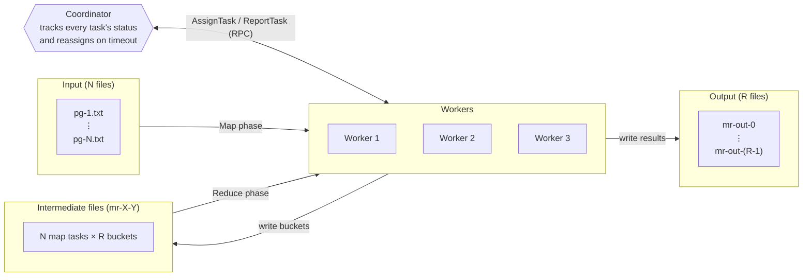

# Distributed MapReduce

## TLDR

A small, fault-tolerant MapReduce framework in Go, based on Google's [MapReduce paper](https://research.google/pubs/mapreduce-simplified-data-processing-on-large-clusters/) and built for Lab 1 of MIT's [6.5840 Distributed Systems](https://pdos.csail.mit.edu/6.5840/) course. Familiarizing yourself with the MapReduce paper is recommended to have the best experience reading through the project.

A single coordinator breaks a job into tasks and hands them out over RPC to any number of workers, which run them in parallel and take over each other's work when one crashes or stalls. In this project, the system processes eight classic books from Project Gutenberg (including *Frankenstein*, *The Picture of Dorian Gray*, *Sherlock Holmes* and *Grimm's Fairy Tales*) to produce two results: a **word count**, which shows how often every word appears across all the books, and a **text index**, which lists which books each word appears in. 

While the application is relatively simple, we're much more interested in the underlying system built around Map and Reduce logic that unlocks distributed computation.

## How it Works

#### `Map()` and `Reduce()`

For starters, the application supplies 2 already-implemented functions:

- **`Map(filename, contents)`** reads one chunk of input and emits key/value pairs. For word
  count, every word becomes a pair like `("whale", "1")`.
- **`Reduce(key, values)`** receives one key together with *every* value emitted for it, and
  combines them into a single result. For word count, `Reduce("whale", ["1","1","1"])` returns `"3"`.

Everything else, such as splitting the work, running it in parallel, moving data between the
two phases and recovering from crashes, is the framework's job. That's what this project
implements.

### Job LifeCycle
A job run follows this process:

1. **Split.** Each input file becomes one Map task. The number of Reduce tasks
   (`nReduce`, 10 here) is fixed up front.

2. **Map.** A worker asks the coordinator for work and gets a Map task. It reads the file,
   calls `Map`, and splits the resulting pairs into `nReduce` buckets using
   `hash(key) % nReduce`. Each bucket is saved as an intermediate file named `mr-X-Y`
   (Map task X, bucket Y).

   > **Why hash?** The same key always lands in the same bucket, no matter which file or
   > worker it came from. So all the "whale"s across every book end up in one place.

3. **Wait.** Reduce can't start until *every* Map task is done, because any Map task might
   still produce a key that a Reducer needs. Until then, idle workers are told to wait and
   check back shortly.

4. **Reduce.** Reduce task Y gathers bucket Y from every Map task (`mr-0-Y`, `mr-1-Y`, …),
   sorts the pairs so that identical keys sit side by side, and calls `Reduce` once per key.
   The results go to `mr-out-Y`.

5. **Finish.** When every Reduce task has reported back, the coordinator marks the job done,
   and the workers are told to exit.

### Surviving failures

Workers can crash, hang, or just be slow, and the coordinator can't tell which. Here, we keep things simple:

- **Timeouts.** Every task records when it was handed out. If it isn't reported finished
  within **10 seconds**, the coordinator assumes the worker is gone and gives the task to the
  next worker that asks.
- **Atomic writes.** Workers write each file under a temporary name and rename it only once
  it's complete. Nobody can read a half-written file, even if a worker dies mid-write.

## Architecture



| Component | Location | Role |
|---|---|---|
| Coordinator | `src/mr/coordinator.go` | Holds all task state, hands out work, detects failures, decides when the job is done |
| Worker | `src/mr/worker.go` | Loops forever: ask for a task, run it, report it, repeat |
| RPC messages | `src/mr/rpc.go` | Message contract between coordinator and workers: task requests/assignments (`AssignTask`) and completion reports (`ReportTask`) |
| Applications | `src/mrapps/` | The `Map` and `Reduce` functions, loaded as Go plugins (`.so`) |

## Sequential vs Parallel

The repo also includes `mrsequential.go`, a reference version that does the same job in
a single process, one step at a time. Both produce identical output. What differs is how
the work gets done:

| | Sequential | Distributed |
|---|---|---|
| Processes | One | One coordinator + any number of workers |
| Map tasks | Run one after another | Run at the same time on different workers |
| Reduce tasks | One big reduce over everything | `nReduce` independent reduces, in parallel |
| Output | A single `mr-out-0` | One file per Reduce task, `mr-out-0` … `mr-out-(R-1)` |
| If something crashes | The whole job is lost | The task is reassigned and the job carries on |
| Scales by | A faster machine | Adding more workers |

The key idea that makes the parallel version possible is the hash partitioning in the Map
phase. Because every key is routed to exactly one bucket, each Reduce task can work
completely independently, with no coordination between them.

## Set Up & Running Tests

### 1. Prerequisites

- **Go 1.22 or newer.** Install it from [go.dev/dl](https://go.dev/dl/), or with
  `brew install go` on macOS. Check it with:
  ```bash
  go version        # should print go1.22 or higher
  ```
- **macOS or Linux.** The system loads applications as Go plugins, which don't work on
  Windows. Windows users can run everything inside [WSL](https://learn.microsoft.com/windows/wsl/install).
- **macOS only:** install GNU `coreutils`, so the test script can enforce its time limits:
  ```bash
  brew install coreutils
  ```

### 2. Clone the repo

```bash
git clone https://github.com/AtypicalAsian/distributed-map-reduce.git
cd distributed-map-reduce/src/main
```

All of the commands below are run from this `src/main` folder.

### 3. Run the test suite

```bash
bash test-mr.sh
```

The script builds everything itself, so there's no separate build step. It checks that
the output is correct (word count and indexer), that Map and Reduce tasks really run in
parallel, that no task runs more often than needed, that nothing exits early, and that the
job survives randomly crashing workers. It takes a minute or two. A passing run looks like this:
```
*** Starting wc test.
--- wc test: PASS
*** Starting indexer test.
--- indexer test: PASS
*** Starting map parallelism test.
--- map parallelism test: PASS
*** Starting reduce parallelism test.
--- reduce parallelism test: PASS
*** Starting job count test.
--- job count test: PASS
*** Starting early exit test.
--- early exit test: PASS
*** Starting crash test.
--- crash test: PASS
*** PASSED ALL TESTS
```

Warnings like `rpc.Register: method "Done" has 1 input parameters` and the occasional
`dial unix ... connection refused` are expected and harmless.

**Extra checks:**
- Catch rare bugs by running the suite many times in a row: `bash test-mr-many.sh 20`
- Check for data races: uncomment `RACE=-race` at the top of `test-mr.sh`, then run it again.

### 4. Run a job by hand (word count)

Open several terminal windows, and `cd` into `src/main` in **each** of them.

**Terminal 1:** build the word-count plugin and start the coordinator.
```bash
go build -buildmode=plugin ../mrapps/wc.go
rm -f mr-out-* mr-[0-9]*
go run mrcoordinator.go pg-*.txt
```

**Terminals 2, 3, …:** start as many workers as you like (one is enough, three is a good demo).
```bash
go run mrworker.go wc.so
```

Every process exits on its own when the job is done, after a few seconds. Then view the result:
```bash
cat mr-out-* | sort | head -20       # the first 20 words and their counts
```

Clean up the generated files before the next run:
```bash
rm -f mr-out-* mr-[0-9]* wc.so
```

## Demo
https://github.com/user-attachments/assets/b56656bf-d079-4281-a4bb-89034662fe84


